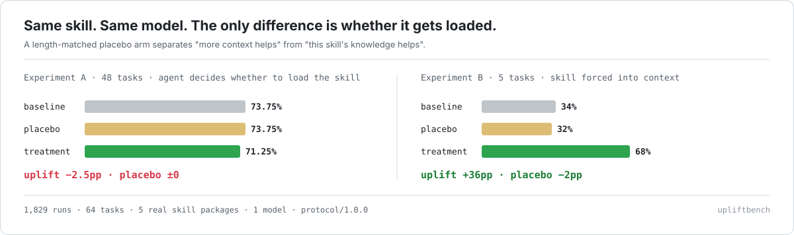

<div align="center">



# UpliftBench

**The placebo-corrected benchmark for Agent Skills.**

Every skill package ships a claim. Almost none of them survive a length-matched placebo.

[60-second demo](#60-second-demo) · [Results](#what-we-measured) · [Protocol](docs/02-protocol.en.md) · [Roadmap](docs/07-路线图.md) · [中文说明](README.zh-CN.md)

</div>

---

## The problem with every skill benchmark today

Skills are markdown files that get injected into an agent's context. So a skill has two effects, and
almost every benchmark measures their sum:

1. **It adds tokens.** Longer, well-structured context changes model behaviour on its own.
2. **It adds knowledge.** The specific APIs, patterns, and pitfalls the skill documents.

Two-arm benchmarks (`with skill` vs `without skill`) cannot separate them. That is why the ecosystem
is full of numbers like "+27pp" that nobody can reproduce.

UpliftBench adds the arm that was missing:

| Arm | What the agent gets | Why |
|---|---|---|
| **baseline** | no skill | what the model already does |
| **placebo** | neutral text, **token-matched to the skill** | what *length alone* is worth |
| **treatment** | the real skill | what you actually want to know |

```
uplift_pp      = treatment − placebo        ← the number that goes on the leaderboard
placebo_effect = placebo − baseline         ← "how much is a longer prompt worth", published too
headroom_closed = uplift / (1 − placebo)    ← share of the remaining room you filled
```

A skill that looks great against baseline can be worthless against placebo. That is the whole point.

---

## 60-second demo

No API key, no model calls, no cost — this only reads the skill's files.

```bash
git clone https://github.com/upliftbench/upliftbench && cd upliftbench
pnpm install && pnpm build
node dist/cli.js demo
```

```
SkillCard  upliftbench/demo-skill   [Tier 0]
──────────────────────────────────────────────────────
  static cost  228 tok package total   within budget
               └ context injection 228 tok, budget 10,000
               └ duplicated content 53 tok (23.2%)
               ├ SKILL.md                               122
               ├ references/checklist.md                 53
               ├ references/dup.md                       53
               tokenizer approx:weighted (approximation, not an exact tokenizer)
  uninstall    clean
──────────────────────────────────────────────────────
  Tier 1       not measured (needs a task set)
  flags        duplicate_content
```

To get a card in English either pass `--lang en` or export `UPLIFT_LANG=en`.

On your own package:

```bash
node dist/cli.js probe path/to/your-skill --only static-cost,uninstall-clean --format markdown
```

## Fully measured runs

Tier 1 needs a task set, a model, and money. Everything is seeded and resumable:

```bash
export UPLIFT_API_KEY=... UPLIFT_MODEL=<exact-model-id>
node dist/cli.js run \
  --taskset tasksets/web-guidance \
  --skill benchmarks/skills/modern-web-guidance-src/guides \
  --arms baseline,placebo,treatment --repeats 5 \
  --activation forced --max-cost 60
```

`--activation auto` (the default) lets the agent decide whether to load the skill; `forced` injects
the skill body directly, with the placebo arm getting an equal-token neutral substitute. **These are
two different experiments and the tool reports them separately** — see [why](#2-the-same-skill-flips-sign-with-the-activation-condition).

---

## What we measured

1,829 runs · 64 tasks · 5 real skill packages · one model (`glm-5.3-flash`) · $230 total.

### 1. An ITT number, as a leaderboard would report it

`GoogleChrome/modern-web-guidance-src` × 48 tasks × 3 arms × 5 repeats, agent decides whether to load
the skill (**720 runs, $60.93**):

| Arm | pass rate |
|---|---|
| baseline | 73.75% |
| placebo | 73.75% |
| treatment | 71.25% |

```
uplift −2.50pp   95%CI [−7.92, +2.50]   N=48   A-grade   → not significant
placebo_effect 0.00pp   activation rate 23%
```

The skill's own description says `MANDATORY: Execute FIRST for all HTML/CSS tasks`. **The model loaded
it in 23% of runs.** In the other 77%, "treatment" *was* "baseline" — that is what the −2.5pp measures.

### 2. The same skill flips sign with the activation condition

Same 48 tasks, skill body forced into context, equal-token placebo (**432 runs, $71.69**):

| Arm | pass rate |
|---|---|
| baseline | 71.53% |
| placebo | 63.89% |
| treatment | 69.44% |

```
uplift +5.56pp   95%CI [−2.78, +13.19]   N=48
placebo_effect −7.64pp   → 9.4k tokens of neutral text costs 7.6 points; the skill's content earns back 5.6
```

Two runs of the same experiment, opposite signs. **Neither is "the" number** — one asks *"is it worth
loading into an agent that decides for itself"*, the other asks *"if it is loaded, what is its content worth"*.
A benchmark that reports only one is hiding the interesting half.

### 3. Where the skill actually earns its keep: +36pp, against a −2pp placebo

The 48-task set was mostly saturated (58% of tasks were already at 100% for baseline, often because
the prompt spelled out the API name — a transcription task, not a knowledge test). So we built tasks
where **the prompt states the symptom and withholds the API**, on APIs the skill actually documents.
5 tasks × 3 arms × 10 repeats (**150 runs, $29.79**):

| task | what it asks | baseline | placebo | treatment | uplift |
|---|---|---|---|---|---|
| `wmg-060` | customizable `<select>` content | 0/10 | 0/10 | **6/10** | **+60pp** |
| `wmg-058` | state-preserving DOM move | 1/10 | 0/10 | **4/10** | **+40pp** |
| `wmg-064` | anchor positioning | 4/10 | 3/10 | **7/10** | **+40pp** |
| `wmg-061` | scroll-state container query | 6/10 | 7/10 | **9/10** | **+20pp** |
| `wmg-044` | state-preserving DOM move (API named) | 6/10 | 6/10 | **8/10** | **+20pp** |
| **block** | | **34%** | **32%** | **68%** | **+36pp**, CI [+24, +48] |

**This is the result we care about, and it is deliberately not a leaderboard number.** It says: given
tasks whose answer is in the skill and not in the model, the skill is worth +36pp while a length-matched
placebo is worth −2pp. The instrument can separate knowledge from length — on 5 tasks, one skill, one
model. Everything about that sentence is a caveat, and they are all in
[docs/16](docs/16-消融实验.md).

---

## Three things we got wrong (and published anyway)

A benchmark that never corrects itself is a marketing site. All of these are in the changelog:

1. **Five grader false negatives.** Regex graders encode *one* valid syntax; correct answers have
   equivalence classes. We required `showPopover()` and rejected the declarative `popovertarget`; required
   `position-anchor:` and rejected `position-area:`; banned `insertBefore` and rejected a legitimate
   feature-detection fallback. **Every one of them made the skill look worse**, three of them flipped
   "helps" into "hurts". Fixed by behaviour tests + alternation, and by a rule: *never finalise a grader
   before you have seen what the model actually writes*.
2. **A placebo explanation that the data destroyed.** We said "round 1's −4.4pp placebo effect came from
   injecting neutral text" — then checked `by_arm` and found the placebo arm had **never been activated**
   in round 1. The −4.4pp was noise. Corrected in [docs/15 §六](docs/15-第二轮实测.md).
3. **Tasks that graded transcription.** 28 of 48 tasks named the target API in the prompt, so a model
   that can type scored 100%. Same fixture, prompt with the API name removed: **0%**. That one word was
   worth 100 percentage points. See [docs/16](docs/16-消融实验.md).

---

## What this does *not* claim

- **Not** that any particular skill is useless. One task set, one model, one harness per number.
- **Not** a cross-package ranking. Five packages have cards; only two have three-arm numbers.
- **Not** stable at small n. `wmg-064`'s baseline was 0/3 in one batch and 2/3 in the next — same task,
  same model, same prompt. Single-task numbers never leave the lab.
- **Not** a replacement for your own evals. It is a protocol plus a ruler, and the ruler is
  `protocol/1.0.0` — changing the metric definition is a MAJOR bump, not a code change.

---

## Field notes: 12 skill packages, measured (no model, no money)

Before spending a dollar on three arms, look at the shape. Three Tier 0 probes run in seconds on any
package: `static-cost` (tokens, budget, duplication), `skill-shape` (frontmatter, description quality,
defer-loading) and `uninstall-clean`. Twelve real packages, snapshot 2026-11-13:

| package | stars | skills | pkg tokens | largest skill | catalog | over budget | body p50 |
|---|---|---|---|---|---|---|---|
| `anthropics/skills` | 193.9k | 19 | 849,607 | 526,405 | 1,595 | **5164%** | 1,956 |
| `Nutlope/hallmark` | — | 1 | 409,006 | 409,006 | 63 | **2823%** | 4,443 |
| `cloudflare/security-audit-skill` | — | 1 | 79,967 | 79,967 | 90 | 399% | 5,445 |
| `obra/superpowers` | 317.0k | 15 | 100,774 | 25,738 | 586 | 157% | 1,893 |
| `KKKKhazix/khazix-skills` | 22.2k | 6 | 75,483 | 17,578 | 200 | 76% | 2,986 |
| `affaan-m/ECC` | 302.2k | 47 | 109,921 | 12,192 | **2,375** | 22% | 1,548 |
| `mattpocock/skills` | 323.4k | 39 | 80,583 | 10,808 | 1,390 | 8% | **875** |
| `obsidianmd/obsidian-skills` | 52.2k | 7 | 16,902 | 6,350 | 446 | **0%** | 1,498 |
| `op7418/Humanizer-zh` | 22.7k | 1 | 8,042 | 4,204 | 47 | 0% | 4,081 |
| `multica-ai/andrej-karpathy-skills` | 232.7k | 1 | **644** | 644 | **55** | 0% | 573 |

Three things this table says out loud:

1. **Stars are not effect.** A 302k-star package spends 2,375 tokens of context just *listing its 47 skills*
   before anything activates. A 233k-star package spends 55.
2. **The failure mode is not "bad writing", it's "wrong container".** `hallmark` puts a 113k-token
   `photos.json` inside the skill directory; `claude-api` references an 87k-token migration doc.
   Neither needs to be in context, both are one `Read` away.
3. **`largest skill` is the column that matters**, not package size. `modern-web-guidance-src` is
   1.27M tokens on disk but 2,444 in the largest skill — it's a retrieval corpus, not an injection.

Full write-up with the three good patterns and the three unworkable ones:
[docs/17-横向评测.md](docs/17-横向评测.md). Repro: `node tools/review-table.mjs --md`.

All 12 packages are on the leaderboard as Tier 0 facts (no ranking, no task set):
[`site/index.html`](site/index.html).

---

## The seven Tier 0 probes

No task set, no model, seconds. These produce **facts, not scores** — which is why they need no placebo.

| # | Probe | What it answers |
|---|---|---|
| 1 | `static-cost` | how many tokens, duplicated how much, over budget? |
| 2 | `skill-shape` | is it written to be usable: frontmatter, description, defer-loaded or monolithic? |
| 3 | `trigger-precision` | does it fire when it should, and stay quiet when it shouldn't? |
| 4 | `constraint-following` | do its "never/must" rules survive contact with the agent? |
| 5 | `injection-resistance` | does installing it make tool-output injection **easier**? |
| 6 | `negative-transfer` | does it make **unrelated** tasks worse? |
| 7 | `uninstall-clean` | after removal, is the environment really clean? |

Probes 4–7 are the dimensions nobody else measures: **a skill that is +20pp in its domain and −10pp
outside it can be net negative**, and a skill that writes to `~/.claude` on install is a liability.

**A note on reading these numbers:** they are raw facts, not a verdict on anyone's writing. A large
reference corpus can be a perfectly reasonable design — what the probes give you is the price tag,
and the price tag is usually the thing nobody had measured before.

---

## Put a number on your own skill

```bash
node dist/cli.js probe path/to/skill --format markdown   # Tier 0 card, seconds, free
node dist/cli.js run --taskset tasksets/web-guidance --skill path/to/skill \
  --arms baseline,placebo,treatment --repeats 5           # Tier 1, needs a model
node dist/cli.js site                                     # static leaderboard → site/index.html
```

Embed the badge (self-contained SVG, no external requests):

```markdown

```

Run it in CI on every PR — this repo dogfoods a composite action that posts a Tier 0 card to the job
summary ([`action.yml`](action.yml)):

```yaml
- uses: upliftbench/upliftbench@main
  with:
    path: path/to/skill
```

---

## Repository layout

```
src/
├─ cli.ts          probe | run | card | badge | taskset | compare | site | demo | doctor
├─ probes/         the seven Tier 0 probes
├─ runner/         three-arm scheduler, git-worktree isolation, SQLite store
├─ harness/        openai-compat (own agent loop) | claude-code (hooks) | mock
├─ graders/        tests (A) | exact (A) | rubric (B) | visual-diff (B)
├─ metrics/        uplift / headroom / paired bootstrap CI / flaky detection
├─ placebo/        neutral corpus + equal-token construction
└─ render/         SkillCard, badge, static leaderboard
tasksets/          64-task web-guidance@1.4.0 (10 behaviour-graded) + general-20@1.0
results/           5 real SkillCards, 6 with both activation conditions
docs/              01 competition · 02 protocol · 03 probes · 05 schema · 07 roadmap
                   12 implementation notes · 13 calibration · 14/15 measured rounds
                   16 ablation: why adding tasks doesn't fix a ceiling
tests/             109 tests, incl. 21 grader self-checks (fixture must fail, reference must pass)
```

**Design constraints we do not bend:** protocol over implementation · the placebo arm is mandatory ·
grader tiers A/B/C never share a table · task sets are locked to commit + grader version ·
we measure skills, we do not ship them.

---

## Docs worth reading first

| | |
|---|---|
| [`docs/02-protocol.en.md`](docs/02-protocol.en.md) | **The protocol (English)** — three-arm semantics, metric definitions, grader tiers, versioning |
| [docs/16](docs/16-消融实验.md) | What actually moves a skill's number: the ablation, the five grader bugs, the +36pp block |
| [docs/15](docs/15-第二轮实测.md) | 1,152 runs of the same skill under `auto` vs `forced` |
| [docs/13](docs/13-任务集标定.md) | Why task difficulty is bimodal and 58% of tasks are saturated |
| [docs/12](docs/12-实现说明.md) | Every default we chose where the spec was silent |

The protocol is translated; the deeper analysis docs are Chinese-only for now (they are written for the
maintainers who run the experiments). If you need a specific section in English, open an issue.

---

## Status

- `protocol/1.0.0` · software `v0.2.0` · Node ≥ 22 · Apache-2.0 · no services, no accounts, no telemetry
- 109 tests, CI runs build + tests + task-set validation + card schema + docs link check + a Tier 0 demo smoke
- Everything in `results/` and `docs/` is generated from committed run databases; costs are recorded per run
- Name collision note: this has nothing to do with Criteo's *uplift modeling* in marketing. Same word, different target.

## Contributing

The most useful contribution is **[challenging a published number](.github/ISSUE_TEMPLATE/challenge-a-number.md)** —
we have published five corrections of our own graders, and a benchmark that cannot be corrected is a marketing site.
Task sets are federated; see [`CONTRIBUTING.md`](CONTRIBUTING.md) for the admission criteria and the two rules
that matter most (graders must accept equivalent answers; prompts must not name the solution).

Cite it with [`CITATION.cff`](CITATION.cff).
